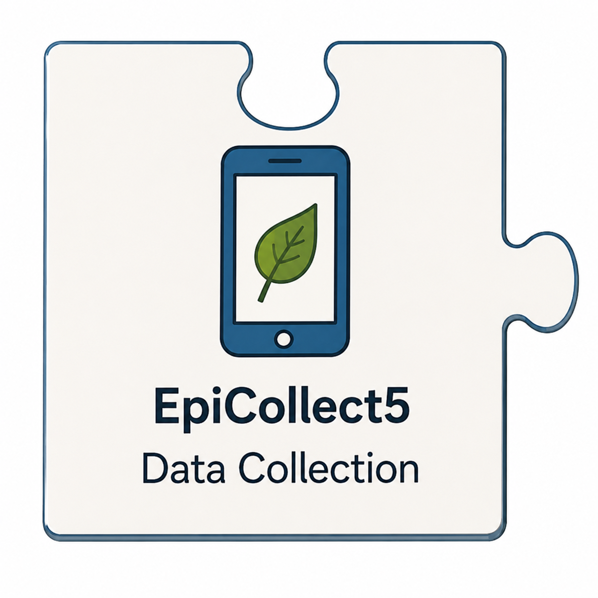

<table border="0" cellpadding="10">
  <tr>
    <td valign="top">
		
    </td>
    <td valign="center">
      
<h2>CAMTREES Database and EpiCollect</h2>

    </td>
  </tr>
</table>

# {{ page.title }}

<a href="https://five.epicollect.net/" target="_blank">EpiCollect5</a> is a free, web-based and mobile data collection platform designed for gathering information in the field. It allows users to create customized electronic forms, collect GPS coordinates, record observations, and upload their findings to a central server.

For the CAMTREES Database project, EpiCollect5 serves as the primary tool for collecting information about American chestnut trees throughout Maine.

CAM volunteers use EpiCollect5 on their smartphones or tablets to record tree plantings, monitor tree health, document care activities, and identify wild chestnut trees. The information they collect is subsequently transferred into the CAMTREES Database for long-term storage, analysis, mapping, and reporting.

## Why EpiCollect5?

EpiCollect5 was selected because it provides a practical, easy-to-use method for collecting standardized field information without requiring volunteers to work directly with the database.

Some of its important features include:

- **Mobile Data Collection** — Volunteers can record observations directly on their smartphones or tablets.
- **Customizable Forms** — Data entry forms can be designed to collect the specific information needed by CAM.
- **GPS Support** — Geographic coordinates can be captured in the field, helping CAM locate and map individual trees.
- **Offline Data Collection** — Information can be recorded without an internet connection and uploaded when connectivity becomes available.
- **Consistent Data Entry** — Required fields, predefined choices, and other form controls help standardize the information collected by volunteers.
- **Centralized Collection** — Submitted observations are stored on EpiCollect5 servers until they are retrieved for processing.

These features are especially useful for volunteers working in forests, orchards, and other locations where cellular service may be limited or unavailable.

## How CAM Uses EpiCollect5

CAM has developed several EpiCollect5 data collection pathways to support different volunteer activities.

### Recording New Tree Plantings

When volunteers plant American chestnut trees, they use EpiCollect5 to record information about the planting.

Depending on the data collection form, this may include the tree's identifying number, planting date, location, and other information needed to establish a record in the CAMTREES Database.

These observations help CAM maintain a record of where trees have been planted and who is responsible for their care.

### Recording GPS Locations

Accurate geographic coordinates are important for mapping planted and wild chestnut trees.

EpiCollect5 allows volunteers to record GPS coordinates in the field. These observations can be used to establish or improve the recorded locations of trees in the CAMTREES Database.

The geographic information is stored in PostgreSQL and can be used with PostGIS for spatial analysis and mapping.

### Monitoring Tree Health and Care

CAM volunteers periodically visit trees to assess their condition and perform maintenance activities.

EpiCollect5 provides forms for recording observations about individual trees or groups of trees, including health assessments and care activities.

These records allow CAM to track changes over time rather than maintaining only a snapshot of each tree's current condition.

### Recording Wild Chestnut Trees

EpiCollect5 is also used to document American chestnut trees growing in the wild.

Volunteers can record the locations and characteristics of wild trees, providing information that may be useful for monitoring, research, and future restoration activities.

CAM supports data collection for both its own wild-tree observations and those associated with The American Chestnut Foundation (TACF).

### Recording Rainfall

CAM Hub Captains also use EpiCollect5 to record rainfall observations.

These reports provide information about local precipitation conditions that may be useful when evaluating the needs of recently planted chestnut trees.

### Requesting New SQL data

CAM Staff use EpiCollect to request new CAM Orgs, HUBs, Parent Trees, Sites, and Volunteers

### Creating Tree Tags

CAM Tree Managers record new Tag ID's that will be placed on trees as they are planted. Tree parents are recorded at the time a new Tag is created.

## Collecting Data Without Internet Access

One of EpiCollect5's most valuable features is its ability to collect information offline.

Volunteers can download the necessary forms to their mobile devices before heading into the field. Once the forms are available on the device, observations can be recorded even when no cellular or Wi-Fi connection is available.

The collected information remains on the device until the volunteer uploads it to the EpiCollect5 servers.

**An important distinction:** Saving an observation on a mobile device does not automatically make it available in the CAMTREES Database. The observation must first be uploaded to EpiCollect5 and subsequently imported into CAMTREES.

This two-step process is especially important for volunteers working in remote areas.

## Transferring EpiCollect5 Data to CAMTREES

EpiCollect5 and CAMTREES are separate systems with different responsibilities.

EpiCollect5 provides the mobile forms and temporary collection environment used by volunteers. CAMTREES provides the centralized PostgreSQL database where information is organized and maintained for long-term use.

Python programs connect these systems by retrieving submitted EpiCollect5 observations and processing them for insertion into the appropriate CAMTREES database tables.

The overall workflow is:

1. **Collect** — A volunteer records information using EpiCollect5.
2. **Upload** — The volunteer uploads the observation to the EpiCollect5 servers.
3. **Retrieve** — A Python program retrieves the submitted information.
4. **Process** — The program interprets the observation and identifies the appropriate database records.
5. **Store** — The information is inserted into or used to update the CAMTREES Database.
6. **Use** — The imported information becomes available for queries, reports, analysis, and mapping.

This separation allows CAM to use EpiCollect5's convenient mobile data collection features while maintaining its own database for managing and analyzing the information.

## Maintaining Data Quality

Consistent and accurate field observations are essential to the usefulness of the CAMTREES Database.

EpiCollect5 helps improve data quality by providing structured forms, predefined responses, and field validation.

However, the quality of the information still depends on volunteers entering accurate observations.

For example, recording the correct tree identifier is important because it helps CAM associate a new observation with the appropriate existing tree record.

Likewise, accurate GPS coordinates help ensure that trees are correctly represented on maps and can be located during future visits.

Additional checks can be performed when Python programs import the observations into CAMTREES.

## Why EpiCollect5 Matters

EpiCollect5 is an important part of the CAMTREES Database system because it connects the work performed by volunteers in the field with the information maintained in the database.

It allows volunteers to contribute valuable observations without needing specialized database knowledge or equipment beyond a smartphone or tablet.

By combining EpiCollect5 for field data collection, Python for data processing, and PostgreSQL for long-term storage, CAM has created a system that supports the ongoing documentation, monitoring, and restoration of American chestnut trees throughout Maine.