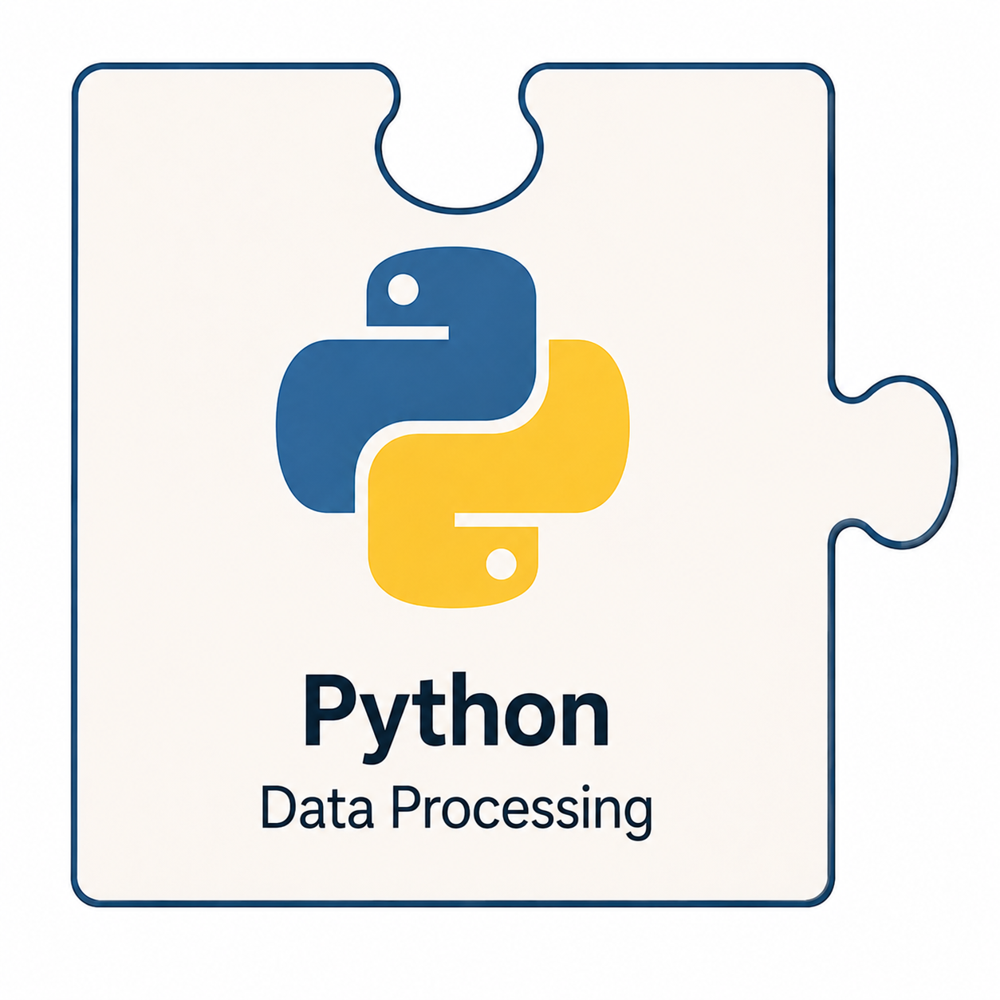

<table border="0" cellpadding="10">
  <tr>
    <td valign="top">
		
    </td>
    <td valign="center">
      
<h2>CAMTREES Database and Python</h2>

    </td>
  </tr>
</table>

# {{ page.title }}

<a href="https://www.python.org/" target="_blank">Python</a> is a free, open-source programming language widely used for data processing, automation, and software development. Its relatively simple syntax, extensive library of reusable code, and ability to work with databases and cloud services make it particularly well suited to the CAMTREES Database project.

Python plays an important role in connecting the various components of our database system. It allows us to retrieve data collected by volunteers, process that information, and transfer it into our PostgreSQL database.

## Importing EpiCollect5 Data

Python's most important role in CAMTREES is importing field data collected by volunteers using the EpiCollect5 mobile app.

Volunteers use EpiCollect5 to record information about newly planted trees, existing trees, and wild chestnut trees. They also record tree health assessments, care activities, and GPS locations.

After volunteers upload their observations to the EpiCollect5 servers, Python programs retrieve the data and prepare it for storage in the CAMTREES Database.

The general process is:

1. **Retrieve Data** — Connect to EpiCollect5 and retrieve data submitted by CAM volunteers.
2. **Process Data** — Interpret the collected information and prepare it for the appropriate PostgreSQL tables.
3. **Update the Database** — Insert new records or update existing records as appropriate.
4. **Make Data Available** — Once imported, the information becomes available for database queries, analysis, reports, and maps.

This approach eliminates much of the manual effort that would otherwise be required to transfer field observations into the CAMTREES Database.

## Database Processing and Maintenance

In addition to importing field observations, Python provides a flexible way to perform database processing and maintenance tasks.

Python programs can connect directly to our PostgreSQL database hosted by <a href="https://neon.com" target="_blank">Neon</a> and execute SQL commands.

This makes Python useful for tasks such as:

- Processing large numbers of database records.
- Performing repetitive database operations.
- Checking data for missing or inconsistent values.
- Preparing data for analysis and reporting.
- Exporting database information for use by other applications.

Although many database operations can be performed directly using SQL, Python is particularly valuable when a task requires multiple processing steps or interaction with an external service.

## Developing Python Programs with PyCharm

We use <a href="https://www.jetbrains.com/pycharm/" target="_blank">PyCharm</a>, an integrated development environment (IDE), to develop and run our Python programs.

An IDE provides tools for writing, testing, debugging, and maintaining software.

PyCharm offers several advantages:

- A code editor with syntax highlighting and error detection.
- Tools for testing and debugging Python programs.
- Management of Python libraries and project dependencies.
- An integrated environment for organizing and maintaining source code.

## Storing Python Source Code in GitHub

The Python programs used by CAMTREES are maintained in our <a href="https://github.com/camtrees/camtrees.github.io/tree/main/scripts" target="_blank">GitHub repository</a>.

GitHub provides version control, allowing database administrators to track changes, review previous versions, and maintain a central collection of the project's source code.

Keeping these programs in GitHub also helps ensure that future database administrators can access and maintain the software without depending on files stored on an individual's computer.

## Automation with GitHub Actions

Python programs are automated to run each morning using <a href="https://github.com/features/actions" target="_blank">GitHub Actions</a>.

Having our various Python programs run as an automated GitHub Actions, allows for:

- Running data imports nightly.
- Executing programs without relying on the administrator's personal computer.
- Maintaining a centralized history of program executions.

## Protecting Database Credentials

Our Python programs require credentials to connect to EpiCollect5 and the PostgreSQL database hosted by Neon.

For security, these credentials are not embedded directly in the Python source code.

Instead, they are stored in two separate locations:
- For running programs on demand (via a database administrator's computer) private data is stored in a local `.env` file. This file is kept private and is not included in the public GitHub repository. Access is limited to authorized CAM staff.
- For running programs automatically via a GitHub Action, private data is stored in <a href="https://docs.github.com/en/actions/how-tos/write-workflows/choose-what-workflows-do/use-secrets" target="_blank">GitHub Action Secrets</a>.

Separating credentials from source code allows the programs to be shared and maintained without exposing sensitive account information.

## Why Python?

Python was selected because it provides a practical combination of simplicity, flexibility, and powerful data-processing capabilities.

It integrates well with the technologies already used by CAMTREES, including EpiCollect5, PostgreSQL, Neon, and GitHub.

Perhaps most importantly, Python allows us to automate repetitive tasks while keeping the underlying programs readable and maintainable.

As the CAMTREES Database continues to evolve, Python will remain an important tool for connecting our technologies, processing volunteer observations, and reducing the manual work required to maintain the system.