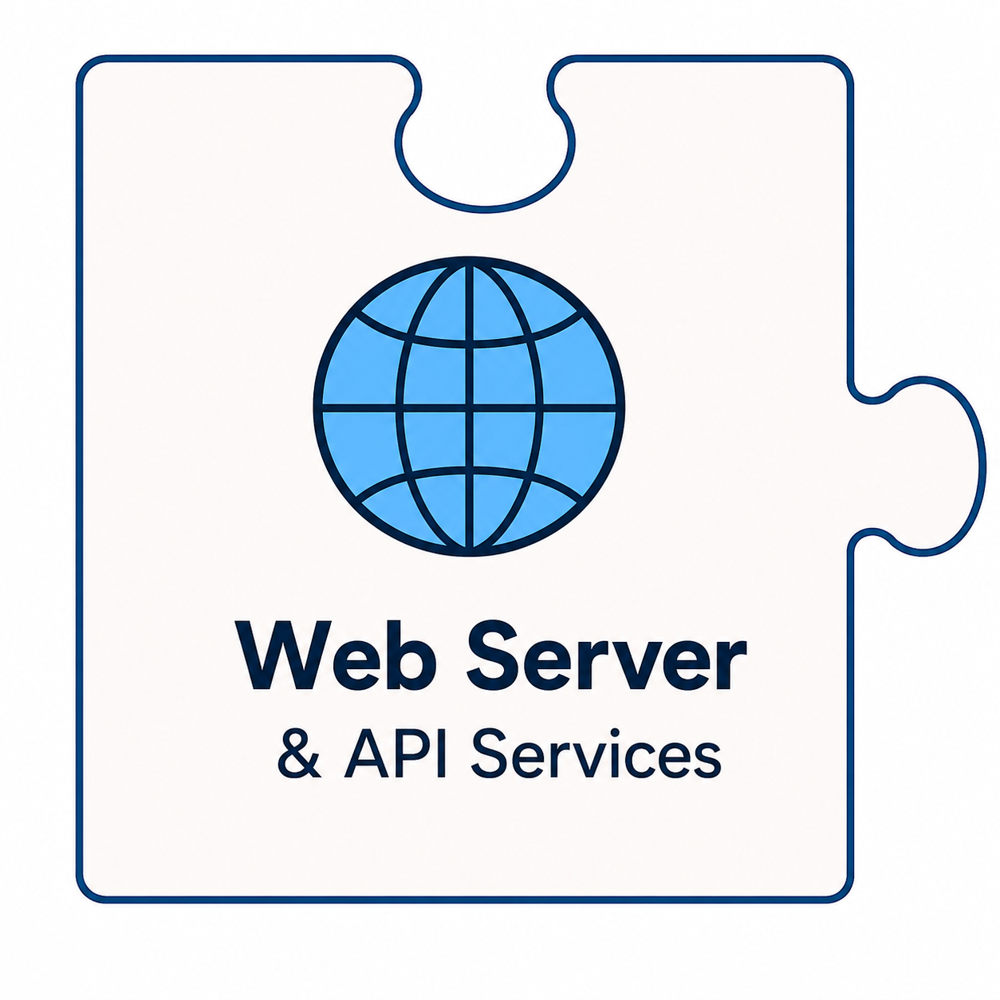
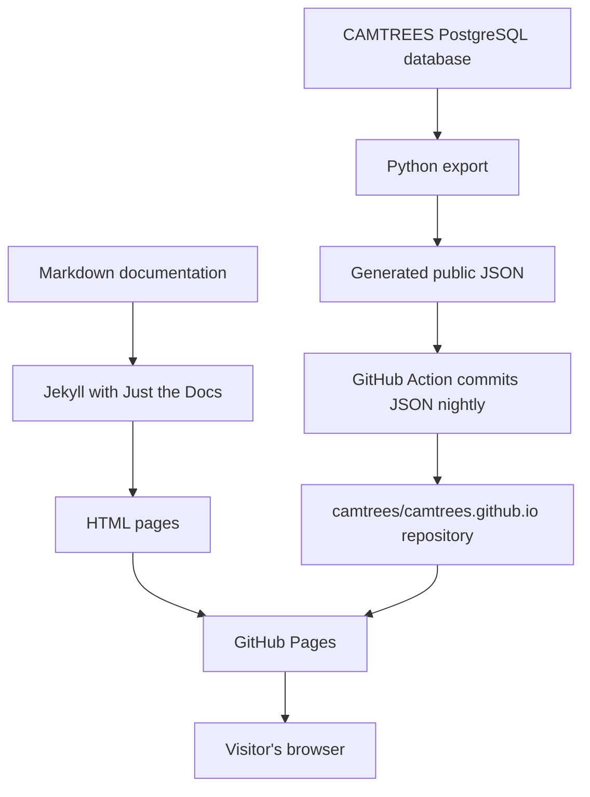

<table border="0" cellpadding="10">
  <tr>
    <td valign="top">
		
    </td>
    <td valign="center">
      
<h2>CAMTREES Database and Web Server</h2>

    </td>
  </tr>
</table>

# {{ page.title }}

The CAMTREES Database website uses GitHub Pages to share project documentation and selected tree records with CAM volunteers and the public. GitHub Pages hosts a static website. It delivers published files such as HTML, CSS, JavaScript, images, and JSON to a visitor's browser. The browser can use those files to provide interactive features, including searchable and sortable tree records.

## GitHub Pages

The website is maintained in the [camtrees/camtrees.github.io repository](https://github.com/camtrees/camtrees.github.io). GitHub Pages hosts the published site, and the repository provides a shared place to maintain the source files and track changes. CAM can publish the site without operating a separate web server. [About GitHub Pages](https://docs.github.com/en/pages/getting-started-with-github-pages/what-is-github-pages)

## Jekyll

Jekyll builds the website from Markdown files, layouts, and other source files. Contributors can write documentation using familiar Markdown elements such as headings, lists, and links. Jekyll converts that content to HTML during the site build and applies shared layouts for a consistent appearance. [Jekyll](https://jekyllrb.com/)

## Just the Docs

Just the Docs is the Jekyll theme that gives the site its documentation layout. It provides the navigation hierarchy that groups pages under sections such as Database Technologies, along with site search and layouts that adapt to different screen sizes. Site search helps visitors find documentation pages. The search and sorting controls on tree tables work with the published tree data. [Just the Docs](https://just-the-docs.com/)

## Publishing CAMTREES Database Information

Python programs retrieve selected records from the CAMTREES PostgreSQL database hosted by Neon and write them to JSON files. JSON is a text format for structured data. Once published with the site, these files are publicly accessible, and JavaScript in the browser reads them to display, search, and sort the published tree records.

A GitHub Action automatically commits the generated JSON files to the `camtrees/camtrees.github.io` GitHub repository each night. GitHub Pages serves the published JSON alongside the website pages.

## How the Website Works

The documentation and database exports follow separate paths to GitHub Pages. Jekyll builds HTML from Markdown using Just the Docs. Python creates the public JSON files from selected PostgreSQL records, and the nightly GitHub Action commits those files to the website repository.

## Keeping the Database and Website Separate

Visitors' browsers read the published files from GitHub Pages without connecting directly to PostgreSQL. Previously published tree records remain available if the database is temporarily offline. The website shows the data in the latest published JSON files, so recent database updates may appear after the next export is published.
